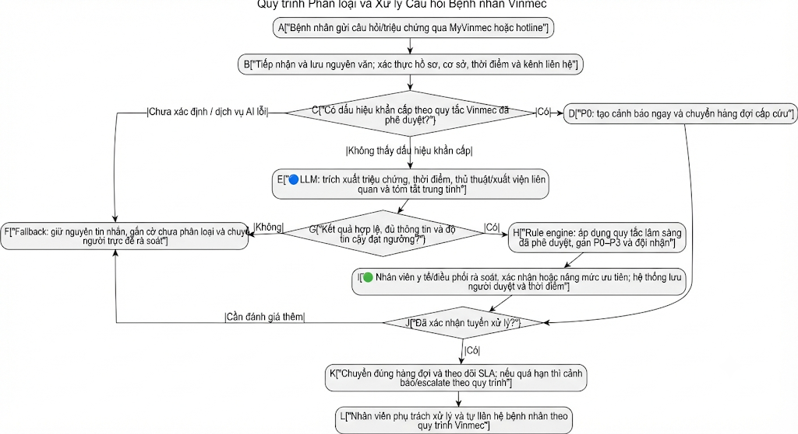

# 3.3. Future-State Flow & AI Fit — CareFollow (Vinmec)

## AI-Fit Matrix

| Lựa chọn | Đánh giá | Vai trò trong CareFollow |
|---|---|---|
| [x] **Rule / State-Machine** | **Bắt buộc cho quyết định an toàn và điều phối.** Quy tắc do Vinmec phê duyệt gán P0–P3, áp SLA, chọn hàng đợi/đội phụ trách và chặn việc hạ mức ưu tiên khi có dấu hiệu nguy hiểm. | Bộ quy tắc có phiên bản, kiểm thử và lưu vết; không để LLM tự quyết định mức độ khẩn cấp. |
| [x] **LLM Feature** | **Phù hợp làm lớp hỗ trợ ngôn ngữ.** Tin nhắn tiếng Việt có thể viết tắt, sai chính tả hoặc mô tả triệu chứng tự do. LLM trích xuất thông tin, chuẩn hóa cách diễn đạt và tạo bản tóm tắt trung tính cho nhân viên. | Đưa ra dữ liệu có cấu trúc và dấu hiệu cần đối chiếu; quyết định ưu tiên cuối cùng vẫn do quy tắc đã phê duyệt và nhân viên y tế kiểm soát. |
| [ ] **Agentic Loop** | **Không chọn.** Tự lập kế hoạch, gọi công cụ hoặc hành động nhiều bước không cần thiết và làm tăng rủi ro trong quy trình y tế nhạy cảm. | AI không tự nhắn bệnh nhân, tư vấn y khoa, chẩn đoán, đặt lịch điều trị hay đóng ca. |

**Kết luận:** CareFollow là **workflow điều phối dựa trên rule/state-machine, có LLM hỗ trợ hiểu ngôn ngữ**. Không dùng LLM như bác sĩ hoặc tác nhân tự hành. Mục tiêu là giúp thông tin đến đúng người đúng SLA, không thay thế đánh giá lâm sàng.

## Future-State Flow

